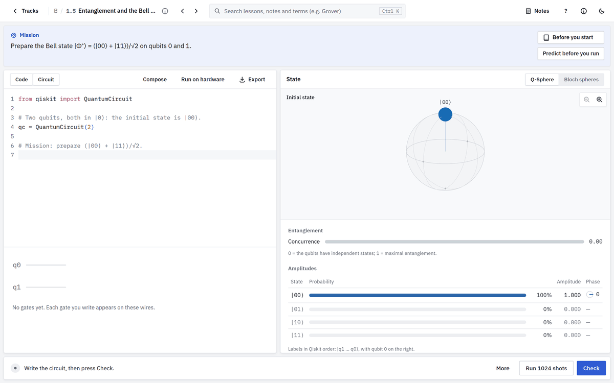
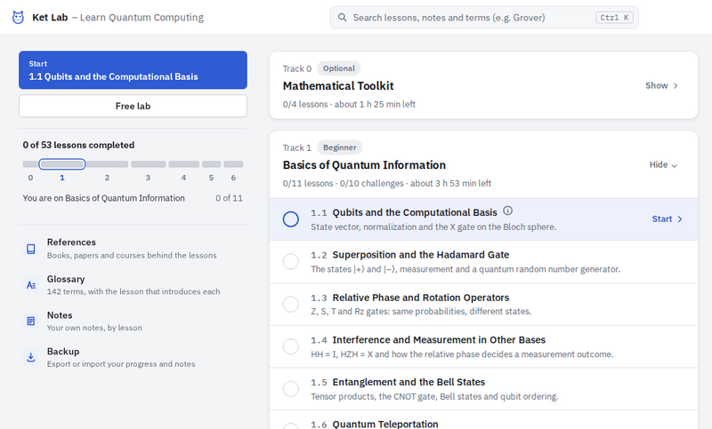
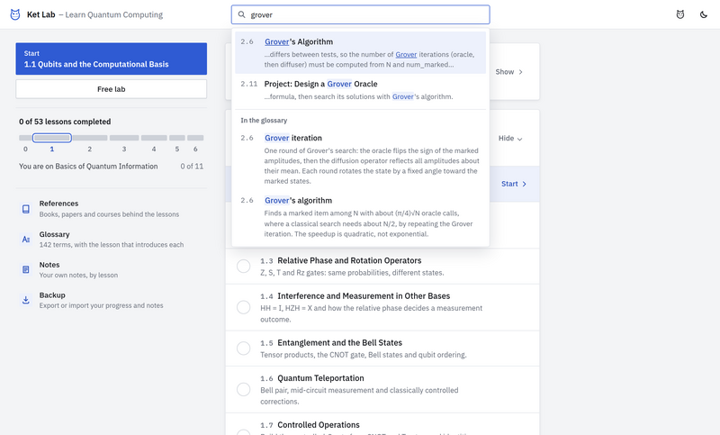

<div align="center">


# Ket Lab

**Learn quantum computing by writing circuits and watching the state change.**

[Open Ket Lab in your browser](https://orlandomotapires.github.io/ket-lab/) &nbsp;|&nbsp; [Wiki](https://github.com/orlandomotapires/ket-lab/wiki) &nbsp;|&nbsp; [Changelog](CHANGELOG.md)

</div>

<picture>
  <source media="(prefers-color-scheme: dark)" srcset=".github/assets/demo-dark.gif">
  
</picture>

Write Qiskit or PennyLane. Each line you type shows up in the circuit, and the state after it shows up on the right: Bloch spheres, the Q-sphere, amplitudes, entanglement. When the mission is done, **Check** compares the physics, not the text, so any circuit that gets the right state passes.

No accounts, no teachers, no deadlines. It's built for one person studying alone, and your progress stays with you.

53 lessons in 7 tracks, from qubits to quantum annealing, about 25 hours in all. [See the curriculum.](https://github.com/orlandomotapires/ket-lab/wiki/Curriculum)

## A closer look

<table>
  <tr>
    <td width="50%">
      <picture>
        <source media="(prefers-color-scheme: dark)" srcset=".github/assets/tracks-dark.png">
        
      </picture>
    </td>
    <td width="50%">
      <picture>
        <source media="(prefers-color-scheme: dark)" srcset=".github/assets/search-dark.png">
        
      </picture>
    </td>
  </tr>
  <tr>
    <td align="center"><sub>Your progress across the tracks</sub></td>
    <td align="center"><sub>One search for lessons, notes and the 142-term glossary</sub></td>
  </tr>
</table>

## Run it

The quickest way is [the browser version](https://orlandomotapires.github.io/ket-lab/). There's nothing to install: Python runs inside the page.

To run it from the source code, you need Python 3.11+ and Node 22+:

```bash
npm run setup   # once
npm run dev     # then open http://localhost:5173
```

With Docker, you need nothing else. The image is published with every release:

```bash
docker pull ghcr.io/orlandomotapires/ket-lab:v0.3.0
docker run --rm --name ket-lab-v0.3.0 -p 127.0.0.1:8080:8080 -v ket-lab-progress:/data ghcr.io/orlandomotapires/ket-lab:v0.3.0
```

Then open http://localhost:8080. Your progress is kept in the `ket-lab-progress` volume.

The wiki explains [running it locally and with Docker](https://github.com/orlandomotapires/ket-lab/wiki/Running-locally), [how it's built](https://github.com/orlandomotapires/ket-lab/wiki/Architecture) and [how to work on it](https://github.com/orlandomotapires/ket-lab/wiki/Development).

## License

[MIT](LICENSE). Third-party libraries and fonts are listed in [THIRD_PARTY_NOTICES.md](THIRD_PARTY_NOTICES.md). Each lesson reference comes from the checked [reading list](docs/verified-references.md).
